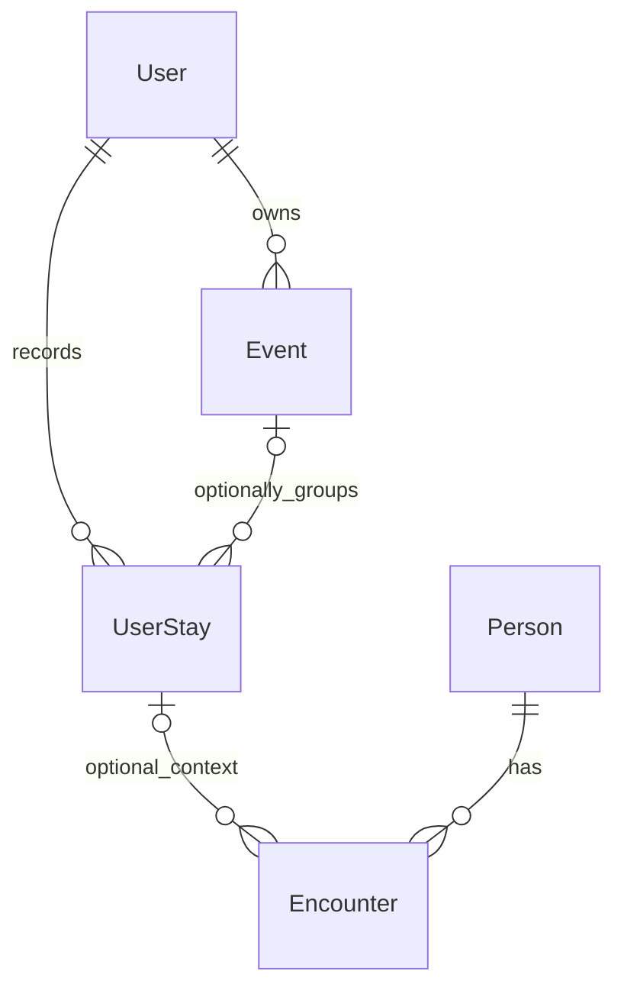

# Love Stories data model, working draft v0.6

Updated November 23, 2026. The initial private persistence layer is implemented
in the isolated Draupnir experiment. See the implementation status below.
Kristian's latest clarification supersedes the earlier
assistant proposal for Person edit-history, dated age-observation, and mandatory
Person assessment-snapshot tables.

## Product direction

Love Stories is a reflection on a relationship as a whole. Person holds the
user's current overall understanding and supports structured analysis. Entries
and encounters preserve stories and meaningful developments. Do not require a
chronological journal or a sequence of profile snapshots to describe a relationship.

Finish the SwipeStats Draupnir/oRPC migration first. Build Love Stories inside
SwipeStats with an independent entry point, usable without dating-data uploads,
like Profile Compare. Reuse its account and database. Keep the API inside
`apps/standalone-web`; shared packages and a separate deployment are not current
requirements.

Every private record belongs to an existing `user.id`. Person is an owner-scoped
private record, not a globally shared identity. Names may repeat. Only a name is
required from the user. All other product fields are optional. The initial physical tables use a `love_` prefix to avoid existing table
collisions.

## Person: current overall profile

Field names and SQL types below are proposals implementing the accepted direction.

| Group               | Proposed fields                                                                                                                                       | Meaning                                                                                                                                                                           |
| ------------------- | ----------------------------------------------------------------------------------------------------------------------------------------------------- | --------------------------------------------------------------------------------------------------------------------------------------------------------------------------------- |
| Identity            | `id`, `userId`, `displayName`, `aliases`                                                                                                              | Stable identity; editable name and aliases.                                                                                                                                       |
| Description         | `tagline`, `summary`, `labels`                                                                                                                        | Overall impression and relationship reflection.                                                                                                                                   |
| Origin              | `originCountryCode`, `originSubdivisionCode`, `originCity`, optional `originPlaceId`, `originLabel`                                                   | Structured geography for analysis plus the original wording. Distinct from residence and nationality.                                                                             |
| Nationality         | `nationalityCodes`                                                                                                                                    | Explicitly supplied nationalities with normalized codes; multiple values allowed.                                                                                                 |
| Current residence   | `currentResidenceCountryCode`, `currentResidenceSubdivisionCode`, `currentResidenceCity`, optional `currentResidencePlaceId`, `currentResidenceLabel` | First-class structured geography, matching origin and prioritized for analysis. Optional `residenceHistory` JSONB array preserves past locations without separate history tables. |
| Age                 | Nullable integers `ageAtFirstMeeting`, `myAgeAtFirstMeeting`; optional per-field estimate metadata; nullable `firstMetYear`                           | Store both people's ages at the same first meeting for direct analysis. Approximate current age is calculated from the meeting year when known.                                   |
| Work                | Free-text `occupation`, nullable typed-string `industry`, `sideOccupations`; proposed `workArrangement` and `remoteRegion`                            | Keep occupation unstructured. Industry is a lightly normalized string, not a fixed database enum. Work arrangement and geographical scope are separate.                           |
| Interests/lifestyle | `interests`, optional supplied habits/descriptors                                                                                                     | A role may also be an interest. Remote work alone does not establish relocation willingness.                                                                                      |
| Appearance          | Optional `heightCm`, separate height label, hair/eye descriptions and other supplied traits                                                           | Sparse details are valid. Display units belong to user preferences.                                                                                                               |
| First contact       | `firstContactMethod`, `firstContactInitiator`, optional platform, structured place/time, optional `firstEncounterId`                                  | Directly queryable on Person. The first encounter may preserve richer context.                                                                                                    |
| Intent              | `lookingFor`                                                                                                                                          | Editable current understanding using dating-app-like categories, such as `long_term_open_to_short`. Supersedes the previous profile value.                                        |
| Overall ratings     | `compatibility`, `chemistry`, optional `overall`, `looks`, `personality`, `humor` and finer dimensions                                                | Independent nullable integers from 1 to 10 for now. Overall user judgments.                                                                                                       |
| Contact/closure     | Freeform context initially; structured pillars deferred                                                                                               | Relationship stage, last reply, intention to call, and closure are different concerns. Do not force them into one guessed roster state.                                           |
| Media               | Optional attachment references                                                                                                                        | Person photos can coexist with encounter attachments.                                                                                                                             |
| Technical metadata  | Timestamps, optional JSON revision/provenance metadata, concurrency version if needed                                                                 | Supporting metadata, not a semantic timeline of perception.                                                                                                                       |

Origin fields are independently nullable. Knowing a country/state never requires
inventing a city. Normalize supplied labels into consistent codes and preserve
the original label. Do not infer ancestry, birthplace or nationality from a
loosely stated origin. Multiple origins remain a later design question.

Current residence has the same independently nullable country/subdivision/city
structure as origin and is a primary analysis dimension. Historical residences
can be a simple nullable JSONB array of location objects, with dates only if
supplied. Do not require a residence-history workflow. Current means the latest
known residence, not proof that the person still lives there today.

Occupation remains free text. Industry is a nullable string with lightweight
normalization or suggestions for grouping; do not add a database enum or an
occupation taxonomy. An occupation does not establish the employer's industry:
for example, an email marketer could work in many industries.

### Work arrangement: two-column recommendation

The user raised a boolean versus one or two classification columns. The current
recommendation is two nullable text columns validated with TypeScript literals:

- `workArrangement`: `in_office`, `hybrid`, or `remote`.
- `remoteRegion`: `americas`, `europe_africa`, `asia_pacific`, or `worldwide`.

Asia-Pacific includes Australia and New Zealand as a coarse availability bucket.
These categories describe work-location/working-hours constraints, not nationality
or residence. More specific country/time-zone exceptions can stay in prose for
now. Do not build a scheduling or country-permission model.

`remoteRegion` is null for in-office/hybrid and may also be null for remote work
whose restrictions are unknown. This preserves a useful remote-but-unspecified
state. Never upgrade an unspecified remote worker to worldwide availability.
In the UI, remote plus worldwide can be labeled Fully remote; other remote
combinations can use the user's suggested regional labels.

For the binary analysis question, derive `requiresOfficePresence`: true for
in-office/hybrid, false for remote, and null when arrangement is unknown. Hybrid
still requires an office location. Do not independently store a boolean that
can contradict the arrangement. This two-column shape is an assistant
recommendation, not a user-confirmed physical schema decision.

### Age at first meeting

`ageAtFirstMeeting` is the canonical nullable integer, exact or estimated. Keep
its original uncertainty in source prose or optional JSON metadata. The age
anchor is settled; no separate age-observation table or birth date is required.
A representative computed from a range needs a documented rounding convention.

Also store `myAgeAtFirstMeeting` directly on Person: the owning user's age at that
same meeting. This intentional duplication makes age-gap and life-stage queries
simple without joining or recalculating from the account on every read. Both ages
are independently nullable; never guess the user's birth year. Prefill from the
user's birth date and meeting date when available, or use a year-level estimate
when only those years are known, retaining estimated status separately for each
age. Manual entry is valid even without a known meeting year.

These are historical values, not live ages. Correcting the meeting date or the
user's birth information should recompute derived values through the same update
path; preserve explicit manual values unless the user corrects them. Calendar
time alone never changes either value. Derive the signed meeting-age gap as
`ageAtFirstMeeting - myAgeAtFirstMeeting` when both are known; a positive value
means the other person was older. No third stored age-gap column is needed now.

Keep `firstMetYear` when known, including when only year-level meeting precision
is available. If a fuller first-meeting date is stored, keep its year consistent
through the same update operation. Never infer the meeting year from capture time.
Approximate current age can be computed as:

`ageAtFirstMeeting + currentYear - firstMetYear`

Show this as an estimate: birthdays and any initial age uncertainty prevent exact
age precision. If the meeting year is unknown, leave current age unknown while
retaining the useful age-at-first-meeting value. Do not overwrite the historical
age column as calendar years pass.

Approach/first contact belongs on Person, including who initiated when supplied.
If also represented on the first encounter, use one update path so corrections
do not leave conflicting duplicates. Person can have first-contact details
without an encounter record.

`lookingFor` reflects the user's current understanding. An earlier interpretation
can remain in its source or an encounter reflection; no intent snapshot is required.

## Perception over time

Update Person fields in place. A meaningful turning point, changed impression,
or contextual exception belongs in an encounter reflection or freeform
relationship reflection when the user wants to retain it. Do not create a
journal entry or assessment for every profile edit.

No `person_change`, `age_observation`, or mandatory dated Person assessment
records are required. Optional JSON revision metadata may support provenance,
debugging or audit needs without modeling the relationship as snapshots/deltas.

Compatibility and chemistry are first-class Person columns. Encounter
assessments may remain separate. Calculated encounter summaries can appear in
the UI or on demand. Recommendation: label calculated results and do not silently
replace manually chosen overall Person ratings. Aggregation is not required now.

Use integer 1-10 ratings for now. Revisit 1-5 or reaction-style scales later.
Earlier ranges remain in the source or optional metadata. A future scale
migration must specify how existing values are interpreted.

## Supporting records

| Record                | Contents and relationship                                                                                                                                                   |
| --------------------- | --------------------------------------------------------------------------------------------------------------------------------------------------------------------------- |
| Entry                 | Owner, optional title, submitted body, capture/update time and source kind; optional occurrence context. Can stand alone or link to multiple people and encounters.         |
| Entry source revision | Optional source-version storage when the submitted text itself is corrected. Source preservation is distinct from Person snapshotting; physical storage remains open.       |
| Entry/person link     | Owner, entry ID, person ID. Many-to-many; name mentions do not automatically create records.                                                                                |
| Encounter             | Stable ID, owner, one person, position, kind, medium/platform, optional status, occurredAt/timeContext, place, description/reflection and optional ratings. Detailed below. |
| Entry/encounter link  | Several entries may revisit one encounter; one entry may describe multiple encounters.                                                                                      |
| Stops/activities      | Optional activity tags and ordered JSONB stops on Encounter. Separate tables are deferred.                                                                                  |
| Encounter assessment  | Optional experience, chemistry and compatibility integers plus reflection directly on Encounter. Separate assessment/snapshot tables are deferred.                          |

### Encounter: simplified working shape

The following adopts Kristian's date/order/channel decisions and the assistant's
simplification choices. Core fields now have experimental storage and operations;
optional future pieces are listed in the implementation status below.

| Fields                                            | Meaning                                                                                                                                                                                  |
| ------------------------------------------------- | ---------------------------------------------------------------------------------------------------------------------------------------------------------------------------------------- |
| `id`, `userId`, `personId`                        | One owner and one subject. Start with a direct Person foreign key; group participants may stay in prose. A participant join table can be added if shared group encounters become useful. |
| `position`                                        | Integer ordering within that person's encounters, independent of capture time and calendar date.                                                                                         |
| `kind`                                            | Nullable typed string: `approach`, `match`, `message`, `call`, `date`, `intimate_encounter`, `other`. Describes the interaction's primary kind; tags can capture additional activities.  |
| `medium`, `platform`                              | Nullable medium: `in_person`, `messaging`, `phone`, `video`. Optional normalized platform string such as `instagram`, `whatsapp`, `tinder`. No platform database enum.                   |
| `initiator`                                       | Optional `me`, `them`, `mutual`, `unknown`, especially useful for first approaches and messages.                                                                                         |
| `status`                                          | Nullable `planned`, `completed`, `canceled`, `no_show`. Unknown stays null; no separate discussed state.                                                                                 |
| `occurredAt`, `timeContext`                       | One nullable main timestamp; supporting nullable JSONB for precision, timezone, original wording and optional relative anchor.                                                           |
| `countryCode`, `subdivisionCode`, `city`          | Independently nullable structured encounter geography.                                                                                                                                   |
| `venueName`, `placeId`, `placeProvider`, `mapUrl` | Optional venue label, namespaced identifier and HTTP(S) map link, including Google Maps. No geocoding or link fetching. Coordinates/address may be added later.                          |
| `userStayId`                                      | Optional future link to the user's own stay; leave absent until the shared stay feature exists.                                                                                          |
| `description`, `reflection`                       | Optional concise account of what happened and the user's interpretation. Neither requires an Entry.                                                                                      |
| `experienceRating`, `chemistry`, `compatibility`  | Independent nullable integers 1–10; the evening's experience versus person-specific judgments during that encounter. No automatic Person-rating overwrites.                              |
| `activities`, `stops`                             | Optional tags and ordered JSONB stops, each with a stable ID, optional venue/place fields and activities. No stop records needed for a simple dinner.                                    |
| `createdAt`, `updatedAt`                          | Record timestamps, never substitutes for when the encounter happened.                                                                                                                    |

**Contact:** remove the proposed `actualContact` boolean. It was intended to
distinguish real interaction from a plan, passive match or unsent draft, but
duplicates much of kind/status. Derive the latest known interaction from a
completed message, call, approach, date or intimate encounter. Exclude passive
matches, unknown status, plans, cancellations and no-shows. A sent Instagram DM
counts as outreach, not evidence of a reply or mutual conversation. Do not use
that derived value to infer closure, reciprocity or roster state; communication
details remain deferred. A no-show with a separate actual message can record that
message independently if useful. Missing calendar dates prevent an exact last-
contact timestamp even when narrative order is known.

**Time:** `occurredAt` holds the known occurrence date/time. Supporting
`timeContext` may contain `{ precision, timezone, label, relativeToEncounterId,
offsetDays }`. An exact date without a clock time can use a consistent local
start-of-day encoding, tagged `precision: day`; the stored clock component is
not an asserted meeting time. Preserve timezone/local-date meaning. Approximate
or relative wording belongs in the supporting field, never in capture time or
a fabricated exact timestamp. Leave `occurredAt` null when no concrete date is
known. For a planned encounter, keep a proposed date in `timeContext.plannedFor`;
populate `occurredAt` only when it happens, using the actual date if it differs.
Resolving a relative date must retain its anchor and precision; do not
build a generalized date-resolution engine now. Encounter duration/end time is
deferred; longer context can remain in prose or the supporting JSON.

**Order:** the UI treats encounters as an ordered list per Person. Append new
records by default; allow insertion/reordering when recounting an older event.
Persist `position`, so undated encounters stay where the user placed them.
When extracting several encounters from an Entry, use the narrated sequence
unless the user supplies a different order. Renumber positions transactionally
when needed, retaining stable encounter IDs. Calendar dates may suggest placement
but never silently reorder a manually arranged story. Position means narrative
sequence, not a claim of an exact date. A date-only analysis can separately sort
known timestamps; do not interleave unknown dates using `createdAt`.

**Place:** this is where an in-person interaction happened, not the subject's
home or the user's residence. City-only input is valid; a named venue is optional.
For messaging/video, the channel is generally sufficient. A linked user stay can
describe where the user was without asserting that both people were there.
Multiple venues can be simple ordered stops within the same encounter.

**Description:** rename the ambiguous `account` to `description`. For example,
"Dinner, then a walk; talked about moving abroad." `reflection` might say,
"Easy conversation, but our plans felt incompatible." These are editable short
fields, not copies that must remain synchronized with Entry bodies. Entries keep
the submitted wording; generated descriptions retain source references and
remain distinguishable from verbatim text.

### Entry: lightweight source and reflection

Use `id`, `userId`, optional `title`, `body`, `sourceKind`, `createdAt`,
`updatedAt`, and optional JSONB occurrence context. Source kind distinguishes
typed text, submitted transcript, import or supplied summary; it does not impose
a journal workflow. An Entry may span a whole relationship, several encounters
or several people, so it needs no mandatory occurrence date or scope enum.

Retain many-to-many `entry_person` and `entry_encounter` links. Multiple Entries
can revisit an Encounter, although the usual case may be one. Entries may have
no encounters; encounters may have no Entries. Source wording and generated
summaries remain distinct. Lightweight source revisions are optional when body
corrections need original-text preservation; no mandatory revision table yet.

No fixed roster-state enum is selected. A story can initially be a view over
Person and linked memories; relationship chapters are an optional later concept.

## Existing Events and user location history: proposal to review

SwipeStats already has an owner-scoped `event` table: name, type, required start,
optional end, and optional location reference. Types include TRIP, NEW_LOCATION,
RELATIONSHIP and other life/app milestones. These feed insight-chart timelines;
keep their user-level meaning. No Love Stories changes to Event are required.

The existing user schema also has a `locationHistory` JSONB column defaulting to
an empty array. Inspection found no active editor or writer for that history.
Current user location updates serve profile/ranking purposes and do not establish
historical stays. The existing location table requires many detailed geographic
fields; do not assume it can already represent sparse city/country-only input.

Encounter and Entry now have the simplified working shapes above. Separately, consider
an owner-scoped `user_stay` as a shared SwipeStats feature: structured city,
subdivision and country, optional place identifier, start/end with precision,
planned versus actual status, and source/import identifier. This is a proposal,
not an accepted schema or implementation task.

A TRIP Event could optionally group several stays; an Encounter could optionally
reference one stay as context. Both references would live on the new records,
leaving Event unchanged. All links must remain within the same owner. Encounters
retain their own place/time: a user's stay does not prove where an encounter
happened, particularly for remote contact. Missing dates/places remain valid.

Keep physical stays distinct from current residence and dating-app/Passport
location. A shared stay timeline could support both insight charts and Love
Stories, including people met per known month spent in a city. Missing history
is unknown coverage; planned stays and overlapping dates must not inflate those
denominators. If a stay table is chosen, make it canonical rather than maintaining
an independent second history in the existing JSONB column.

Nomads' [public profiles](https://nomads.com/@timmetz) show city/country stays,
date ranges, durations and travel summaries. Its [official MCP documentation](https://nomads.com/mcp)
documents authenticated reading and editing of a member's own trips. This makes
an optional import plausible; no connection or import has been implemented.
Borrow the stay-based interaction first. A product integration needs assessment
of its business licensing, which the same documentation distinguishes from
personal use. Imported records need stable source IDs and explicit correction
handling before synchronization is considered.

## Extraction and direct updates

Preserve submitted words verbatim and make extraction attributable to the
source/version. Direct facet edits work independently of journaling. Extraction
runs/candidates may be versioned without versioning every Person profile.

Partial patches preserve omitted fields; explicit null clears nullable values.
Re-extraction must respect explicit edits and clears. Lightweight per-field JSON
metadata, such as source references and manual-set/manual-clear markers, can
support this. A separate override-history table is not required. Exact storage
remains open. Old source extraction must not replace newer explicit corrections.

Ownership constraints, retry receipts and concurrent-edit protection remain
technical requirements separate from the relationship's history model.

## Deferred choices

- Origin semantics, location normalization and multiple origins.
- Representative-age rounding convention; the first-meeting anchor is settled.
- Confirm the two-column work-arrangement/remote-region recommendation.
- Roster, communication, next-action and closure pillars.
- Optional rating dimensions and encounter-level summaries.
- Intent categories, including uncertain or unclassified values.
- Physical source-revision and JSON metadata storage.

## Implementation status (November 23)

Generated migration `0021_love_stories` is applied only to the isolated experiment.
Five tables: `love_person`, `love_encounter`, `love_entry`, `love_entry_person`,
`love_entry_encounter`. Names are not unique. The canonical owner-scoped oRPC
operations live under `loveStories` in the existing web app.

Implemented: create/read/update/delete, bounded lists, explicit encounter order,
entry links, owner export, source preservation, nullable clearing, version checks
against stale edits, and request-key/hash deduplication for create retries while
records exist. Entry stores immutable `originalBody` alongside editable `body`;
intermediate revisions are not retained. Person deletion removes encounters and
links but keeps Entries; account deletion removes all owned records. Anonymous
account transfer preserves records and links transactionally. Composite encounter
ownership is also enforced by a database foreign key; entry-link ownership is
validated inside serialized owner transactions. No narrative analytics events
or new MCP access are enabled.

The temporary `/experiments/love-stories/workspace` screen exercises saves and
reloads. It is a form-based test surface, not the intended product interface.
The existing fictional `/experiments/love-stories` preview remains unchanged.

**Product direction:** nearly all updates should happen through an external MCP
connector or in-app conversation. The browser primarily displays people,
structured facts, encounters and reflections. The display-first
[Paper mockup](https://app.paper.design/file/01M832D61ZDPMKY8QMSXHCMDSZ/p-1-0)
contains a people overview and person story with a contextual chat rail. It uses
fictional examples only. Chat responses, search, filters, patterns and connector
controls in Paper are design illustrations, not implemented integrations.

Remaining: Love Stories-specific connector grants/tools, in-app chat and capture
orchestration, field-level extraction provenance and manual-edit precedence,
media, `firstEncounterId` synchronization, automatic age prefilling, and the
shared user-stay feature. Both age values can already be entered and queried.
Relative-date context is stored without an automatic resolution engine. The
work-arrangement/region pair is the implemented working choice, still revisable.

Validation: `bun check` passes (68 tests, 281 assertions). The guarded
`apps/standalone-web/scripts/verify-love-stories.ts` passes ownership denials,
concurrent append ordering, stale-edit/reorder rejection, duplicate capture
handling, original text, link rollback, owner export, browser save/reload,
mobile overflow, transfer and account-deletion cascades. It creates only
fictional temporary accounts and removes them afterward. The test screen blocks
its content from session replay using documented
[PostHog](https://posthog.com/docs/session-replay/privacy) and
[Amplitude](https://www.amplitude.com/docs/session-replay/manage-privacy-settings-for-session-replay)
content-exclusion markers. Existing consent rules remain in force.

## Boundaries and sources

Keep private narratives and identifying details out of public profiles, research
exports, rank calculations and telemetry. Account transfer/deletion, export and
connector access need explicit coverage. Preservation does not prevent deletion.

Current authority: Kristian's November 23 clarification in this conversation.
See [product direction](love-stories-product-evaluation.md), the historical
[schema discovery](../../love-stories/docs/schema-discovery.md) and
[original design](../../love-stories/docs/love-stories-design.md). Interpret
older requirements subject to the current direction above.

Real-person examples and corrections stay only in the ignored
`love-stories/.local-fixtures/` directory. This document contains design only.
